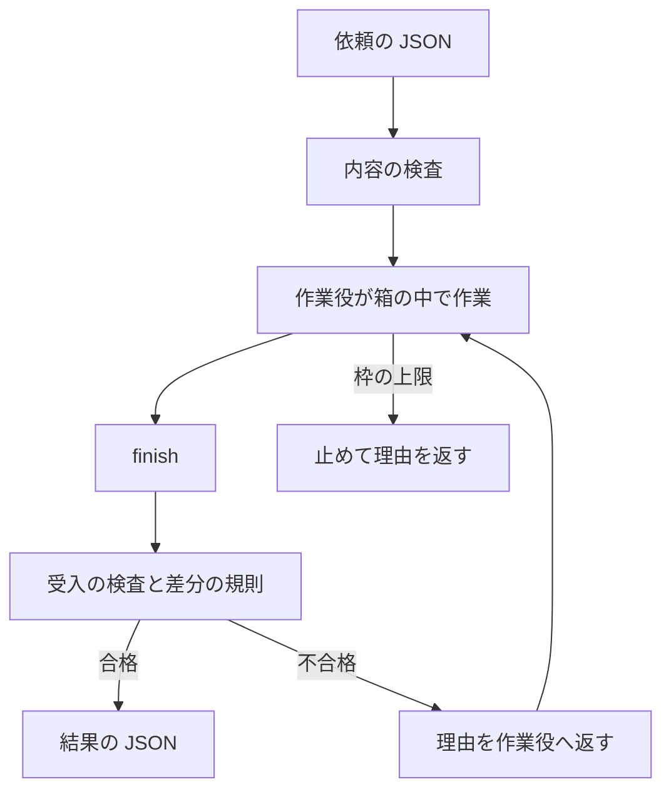

<div align="center">

# nipus-harness

### Codex の作業役を少ない枠で動かすハーネス

[](package.json)
[](tsconfig.json)
[](#インストール)
[](LICENSE)

**依頼の JSON を渡すと、作業役が箱の中で作業し、受入の検査が通るまで続けて、結果を JSON で返します**

---

</div>

## 概要

ChatGPT のプランの枠で Codex のモデルを動かす、作業役専用のハーネスです。親のエージェントや台本から呼ぶ事を想定しています。作業役に毎回送る固定の部分を小さくし、作業役の出来を受入の検査で確かめます。

素の Codex を MCP と plugin なしで圧縮の線を 15 万まで絞り、同じ題材で比べました (`gpt-6.1-terra`、effort は `medium`、各 2 回、結果の検査は全部合格)。

| 比べた物 | ハーネス | 素の Codex | 比 |
|---|---|---|---|
| 最初の呼び出しの入力 | 約 760 トークン | 約 15,300 トークン | 5% |
| 小さい不具合修正 (枠の換算) | 0.00098% | 0.00255% | 38% |
| 小さい言語処理系 (枠の換算) | 0.00346% | 0.00432% | 80% |

呼び出しの回数が増える作業では逆に高くなる事があります。開発途中の版の測定ですが、サイトを別の仕組みに移す作業では素の Codex の 1.36 倍かかりました。

Sign in with ChatGPT の、[オープンソースと手元で動かすアプリ向けの経路](https://developers.openai.com/siwc/token-sharing-open-source)を使います。OpenAI の公式の物ではありません。

## 特徴

| 機能 | 内容 |
|---|---|
| 小さな固定部分 | 作業役の道具は `inspect`・`run`・`edit`・`finish` が基本で、指示は短い固定の文だけ |
| 受入 | `acceptance` のコマンドが通るまで自動で続ける。`specs` と `questions` で、節ごとに証拠の場所を求められる |
| 箱 | 既定の `box: "mxc"` では、読めるのは `workspace` と `read_roots` だけで、ネットにも出られない。Unity などを動かす時は `"none"` で外す |
| 枠の上限 | `max_quota_percent` が 1 回の実行の上限。週の枠が 99% になると自動で止まる |
| 送信の検査 | 送るモデルと道具を実行の設定と照らし、許可した相手にだけ送る。呼び出しごとの量を `ledger.jsonl` に記録する |
| 差分の規則 | `scope` の範囲外の変更、新しい文書や依存、`@ts-ignore`、残った TODO を不合格にする |
| 子の作業役 | `roles` で親と別のモデルと上限を決められる |
| 順番待ち | `host_jobs` で箱の外の重い処理を名前付きで渡し、PC 全体で 1 つずつ流す |
| 調べ物 | `web` で検索と取得を許す。`questions` の `sources` で根拠の数を求められる |
| クリーンルーム | `clean-copy`→`run`→`audit`→`export` で、許した物だけを写した場所で作らせ、差分だけを持ち出す |
| MCP | `mcp` に書いたサーバーの、書いた道具だけを作業役に見せる |
| 高速モード | `service_tier` に `"priority"` と書いた時だけ使う |
| 止めて再開 | `status`・`stop`・`resume`。PC が止まっても続きから再開できる |

## 処理フロー



## インストール

| 必要な物 | 用途 |
|---|---|
| Windows 10 / 11 (x64) | 他の OS では動きません |
| Node.js 22.19 以上 | 本体。`.tools\node\node.exe` があれば、そちらを優先します |
| Git | 差分の確認 |
| [Codex CLI](https://github.com/openai/codex) | 箱と週の枠の読み取りに使います (`npm install -g @openai/codex`)。別の場所にあれば `HARNESS_CODEX_EXE` で指定します |
| ChatGPT のプラン | モデルの呼び出しに使います |

```powershell
git clone https://github.com/cUDGk/nipus-harness
cd nipus-harness
npm ci
bin\harness.cmd login
```

`login` は同意の URL を `.agent\login_url.txt` に書きます。ブラウザで開いて許可すると終わります。トークンは `.agent` に置かれ、本人と SYSTEM だけが読めます。

## 使い方

依頼を JSON で書きます。`workspace` は git のリポジトリにします。

```json
{
  "id": "example",
  "goal": "Update the application and run the checks.",
  "workspace": "C:\\path\\to\\workspace",
  "model": "gpt-6.1-terra",
  "effort": "medium",
  "max_quota_percent": 1.0,
  "acceptance": [
    { "id": "tests", "command": "npm test", "timeout_s": 120 }
  ]
}
```

```powershell
bin\harness.cmd run task.json
```

出力の最後の行が結果の JSON です。`status`・`reason`・`summary`・`usage`・`checks`・`diff`・`run_dir` が入ります。記録は `runs\` に残ります。他の例は [examples](examples) にあります。

| `status` | 意味 |
|---|---|
| `completed` | 受入まで全部通った |
| `blocked` | 作業役が進めないと判断した。`reason` を読み、原因を直して `resume` する |
| `needs_judgment` | 人の判断が要る違反か、続けても進まない状態 |
| `budget_exhausted` | 枠の上限に達した |
| `failed`・`cancelled` | 失敗か、`stop` で止めた |

### 依頼の欄

| 欄 | 内容 |
|---|---|
| `id`・`goal`・`workspace` | 必須。`id` は英数字と `-`・`_`、`workspace` は絶対パス |
| `model`・`effort` | 必須。一覧に無い新しい `gpt-` の名前も書けます。その時は枠を一番重く数えます |
| `acceptance` | 受入のコマンド、または `host_jobs` の名前 |
| `max_quota_percent`・`max_continues`・`max_run_s` | 枠の上限、続ける回数、時間の上限 |
| `specs`・`questions` | 仕様の節ごとの確認、答えと根拠の要求 |
| `scope` | `allow`・`protected`・`allow_docs`・`allow_new_deps`・`max_added_lines` |
| `box`・`read_roots`・`env`・`path` | 箱の有無、読める場所、環境変数、道具のフォルダ |
| `roles` | 子の作業役 |
| `host_jobs`・`host_queue_timeout_s` | 箱の外の処理と、順番待ちの上限 |
| `web` | `search_url`・`fetch`・`max_requests`・`allow_unboxed` |
| `mcp` | サーバーごとの `command`・`tools`・`env`・`timeout_s`・`start_timeout_s`・`lock` |
| `clean_room`・`forbidden_terms_file` | クリーンルームの作業と、送らせない言葉 |
| `service_tier` | `"default"` または `"priority"` |

### コマンド

| コマンド | 内容 |
|---|---|
| `run <task.json>` | 実行する |
| `mcp-tools <task.json>` | MCP の道具の名前を一覧にする |
| `status [run_dir ...]`・`status --active` | 状態を見る |
| `stop <run_dir>` | 止める |
| `resume <run_dir> [--max-quota-percent <数>]` | 続きから再開する |
| `clean-copy <宣言.json>`・`audit <run_dir>`・`export <run_dir> <out.patch>` | クリーンルームの手順 |
| `login`・`help` | ログインと、使い方の表示 |

### この PC の設定

調べ物の検索先は [SearXNG](https://github.com/searxng/searxng) と同じ JSON を返すサーバーです。依頼の `search_url`、環境変数 `HARNESS_SEARCH_URL`、`.agent\harness.json` の順に見ます。

```json
{
  "search_url": "http://search-server:8888",
  "hide_env": "^MY_PARENT_APP_"
}
```

`hide_env` には、`box: "none"` の作業役や MCP サーバーに渡したくない環境変数の名前を正規表現で書きます。名前に `TOKEN`・`SECRET`・`PASSWORD` などを含む物は、書かなくても渡しません。

## 試験

```powershell
npm test
```

箱の試験は Codex CLI を実際に使います。モデルは呼びません。

## Attribution

作業役の本体に [pi](https://github.com/earendil-works/pi) (`@earendil-works/pi-coding-agent`、MIT) を使っています。

## ライセンス

[MIT](LICENSE)
